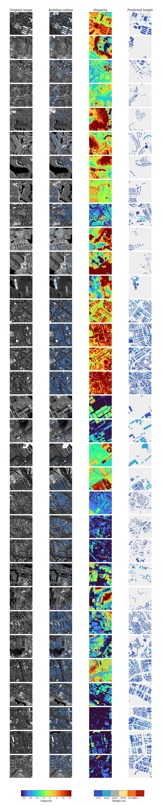

# SD2H-Net: From Differential Disparity to Urban Elevation

SD2H-Net is a physically constrained framework for large-scale building height estimation from GaoFen-7 (GF-7) stereo imagery. The method first learns robust satellite stereo disparity on WHU-SSIDE, then adapts the stereo-derived differential disparity signal to building height estimation on UnifiedBH using building-instance masks and weak height supervision.

The core idea is simple: instead of reconstructing a full DSM and subtracting a DTM, SD2H-Net constructs a local roof-ground differential disparity signal and calibrates it into building height at the instance level.

## Highlights

- Satellite-stereo disparity pre-training on WHU-SSIDE.
- GF-7 building height adaptation on UnifiedBH.
- Local ground disparity estimation and roof-ground differential disparity construction.
- Instance-level height calibration with building masks and weak labels.
- Intra-city and cross-city evaluation protocols.


The figure below illustrates representative UnifiedBH patches and the intermediate products used by SD2H-Net. From left to right, each row shows the original GF-7 patch, the same patch with all pre-filtering building-label contours overlaid in blue, the pre-trained stereo disparity map, and the final building-height prediction map.



## Repository Layout

```text
SD2H/
├── config/                         # Hydra configs for pre-training and height adaptation
├── core/                           # SD2H-Net model, stereo datasets, height datasets, utilities
├── tools/                          # Dataset/cache preparation and plotting utilities
├── plotting/                       # UnifiedBH figure generation scripts
├── checkpoints/                    # Released or reproduced model checkpoints and protocol files
├── pretrained/                     # DepthAnythingV2 weights
├── train_pretrain.py               # WHU-SSIDE disparity pre-training
├── train_finetune.py               # UnifiedBH height adaptation
├── evaluate_stereo.py              # Disparity evaluation
├── evaluate_height.py              # Building height evaluation
├── precompute_unifiedbh_disp_delta.py
├── run_train.sh
├── run_finetune.sh
├── run_evaluate.sh
└── run_plot_stereo_calibration_protocols.sh
```

## Environment

The experiments were developed with Python 3.8 and PyTorch 2.x. A CUDA-enabled GPU is required for training and recommended for evaluation.

```bash
conda create -n sd2h python=3.8 -y
conda activate sd2h
```

Install PyTorch according to your CUDA version. For CUDA 11.7:

```bash
pip install torch==2.0.1 torchvision==0.15.2 torchaudio==2.0.2 \
  --index-url https://download.pytorch.org/whl/cu117
```

Install the remaining dependencies:

```bash
pip install \
  accelerate==1.0.1 \
  hydra-core \
  omegaconf \
  tqdm \
  numpy \
  scipy \
  opencv-python \
  scikit-image \
  matplotlib \
  pillow \
  timm==0.6.13 \
  wandb \
  scikit-learn \
  rasterio
```

Optional packages used by some analysis scripts:

```bash
pip install fvcore
```

## Pretrained Weights

Place DepthAnythingV2 weights under `pretrained/`:

```text
pretrained/
├── depth_anything_v2_vits.pth
├── depth_anything_v2_vitb.pth
└── depth_anything_v2_vitl.pth
```

The released or reproduced SD2H checkpoints are expected under:

```text
checkpoints/
├── pretrain_whusside_60ep_724/
├── city_stratified_10_90/
├── city_stratified_20_80/
├── city_stratified_50_50/
└── quality_diverse_cross_city_hz_dg_058_sz_dg_038_to_7cities/
```

## Data Preparation

### WHU-SSIDE

WHU-SSIDE is used for disparity pre-training and disparity evaluation. This dataset is provided by the WHU-SSIDE authors; please download it from the official repository and follow their license and citation requirements:

- WHU-SSIDE repository: [zhanggb1997/WHU-SSIDE](https://github.com/zhanggb1997/WHU-SSIDE)

We thank the WHU-SSIDE authors for releasing this GF-7 satellite stereo benchmark. After downloading the dataset, organize it with the following structure:

```text
WHU-SSIDE/
├── train/
│   ├── ImageL/
│   ├── ImageR/
│   └── Disp/
└── valtest/
    ├── ImageL/
    ├── ImageR/
    └── Disp/
```

Update the paths in `config/train_pretrain.yaml`:

```yaml
train_data_path: /path/to/WHU-SSIDE/train
val_data_path: /path/to/WHU-SSIDE/valtest
```

### UnifiedBH

UnifiedBH is used for building height adaptation and evaluation. The `overlap15` release can be downloaded from Baidu Netdisk:

- UnifiedBH `overlap15`: [Baidu Netdisk](https://pan.baidu.com/s/1i1sF8wnDNjp2yV-oGfpl1Q?pwd=bhey)
- Extraction code: `bhey`

After downloading and extracting the dataset, the expected structure is:

```text
UnifiedBH/overlap15/
├── left/
│   └── <CITY>/*.tif
├── right/
│   └── <CITY>/*.tif
├── label/
│   └── <CITY>/*.tif
├── mask/                          # optional; masks can also be generated from labels
│   └── <CITY>/*.tif
└── disp/
    └── sd2h_full9_abs_groundfix_whusside724_20260622/
        ├── disp_npy/
        ├── delta_abs_npy/
        ├── delta_signed_npy/
        ├── delta_relu_npy/
        ├── delta_reverse_relu_npy/
        ├── local_ground_npy/
        └── instance_metrics.csv
```

The default configs use the following cities:

```text
HZ_049 HZ_050 HZ_057 HZ_DG_058 SZ_060 SZ_061 HK_062 SZ_DG_038 PRE_039
```

Update dataset paths in the height configs, for example:

```yaml
train_data_path: /path/to/UnifiedBH/overlap15/
val_data_path: /path/to/UnifiedBH/overlap15/
precomputed_disp_delta_root: /path/to/UnifiedBH/overlap15/disp/sd2h_full9_abs_groundfix_whusside724_20260622
```

## Quick Start

### 1. Disparity Evaluation on WHU-SSIDE

If the pre-trained disparity checkpoint is available, run:

```bash
python3 evaluate_stereo.py \
  --restore_ckpt checkpoints/pretrain_whusside_60ep_724/final.pth \
  --data_path /path/to/WHU-SSIDE/valtest \
  --dataset whusside \
  --valid_iters 16 \
  --batch_size 1 \
  --mixed_precision
```

To save disparity visualizations:

```bash
python3 evaluate_stereo.py \
  --restore_ckpt checkpoints/pretrain_whusside_60ep_724/final.pth \
  --data_path /path/to/WHU-SSIDE/valtest \
  --dataset whusside \
  --valid_iters 16 \
  --batch_size 1 \
  --mixed_precision \
  --save_vis \
  --output_directory outputs/whusside_disp_vis
```

### 2. Disparity Pre-training

Edit `config/train_pretrain.yaml`, then run:

```bash
PY=python3 bash run_train.sh
```

or directly:

```bash
accelerate launch \
  --num_machines=1 \
  --num_processes=4 \
  --mixed_precision bf16 \
  train_pretrain.py
```

Important config fields:

```yaml
train_dataset_name: whusside
val_dataset_name: whusside
train_data_path: /path/to/WHU-SSIDE/train
val_data_path: /path/to/WHU-SSIDE/valtest
save_path: ./checkpoints/pretrain_whusside_60ep_724/
min_disp: -320
max_disp: 64
epochs: 60
```

### 3. Precompute UnifiedBH Disparity and Differential Disparity

UnifiedBH height adaptation can use precomputed disparity, local ground disparity, and differential disparity maps. This is the recommended reproducible path because it keeps stereo evidence fixed during height adaptation.

```bash
python3 precompute_unifiedbh_disp_delta.py \
  --data_path /path/to/UnifiedBH/overlap15 \
  --restore_ckpt checkpoints/pretrain_whusside_60ep_724/final.pth \
  --output_root /path/to/UnifiedBH/overlap15/disp/sd2h_full9_abs_groundfix_whusside724_20260622 \
  --cities HZ_049 HZ_050 HZ_057 HZ_DG_058 SZ_060 SZ_061 HK_062 SZ_DG_038 PRE_039 \
  --valid_iters 16 \
  --batch_size 1 \
  --mixed_precision \
  --skip_existing
```

If cached disparity already exists and only label-dependent delta maps or instance metrics need to be synchronized with the current tiles, use:

```bash
DATA_ROOT=/path/to/UnifiedBH/overlap15 \
CACHE_ROOT=/path/to/UnifiedBH/overlap15/disp/sd2h_full9_abs_groundfix_whusside724_20260622 \
PY=python3 \
bash run_rebuild_stereo_calibration_inputs.sh
```

### 4. Prepare Height Adaptation Protocols

Generate leakage-safe train/validation manifests and protocol configs:

```bash
DATA_ROOT=/path/to/UnifiedBH/overlap15 \
CACHE_ROOT=/path/to/UnifiedBH/overlap15/disp/sd2h_full9_abs_groundfix_whusside724_20260622 \
PY=python3 \
bash run_prepare_stereo_calibration_protocols.sh
```

This creates protocol files under:

```text
checkpoints/stereo_calibration_protocols_seed724/
```

### 5. Height Adaptation on UnifiedBH

Run all released protocols:

```bash
PY=python3 GPU_IDS=0,1 NUM_PROCS=2 bash run_train_stereo_calibration_protocols.sh
```

The script trains:

```text
train_quality_diverse_cross_city
train_city_stratified_10_90
train_city_stratified_20_80
train_city_stratified_50_50
```

You can also run one protocol:

```bash
python3 -m accelerate.commands.launch \
  --num_processes=1 \
  train_finetune.py --config-name train_city_stratified_50_50
```

Main outputs:

```text
checkpoints/city_stratified_50_50/
├── finetune_best_rmse.pth
├── finetune_best_score.pth
├── finetune_best_high30_rmse.pth
└── train.log
```

## Evaluation and Visualization

### Height Evaluation

Evaluate a trained height adaptation checkpoint:

```bash
python3 evaluate_height.py \
  --config_yaml config/train_city_stratified_50_50.yaml \
  --restore_ckpt checkpoints/city_stratified_50_50/finetune_best_rmse.pth \
  --data_path /path/to/UnifiedBH/overlap15 \
  --eval_cities HZ_049 HZ_050 HZ_057 HZ_DG_058 SZ_060 SZ_061 HK_062 SZ_DG_038 PRE_039 \
  --output_directory outputs/city_stratified_50_50_eval \
  --batch_size 2 \
  --valid_iters 0 \
  --mixed_precision \
  --no_bin_metrics
```

To save predicted height maps:

```bash
python3 evaluate_height.py \
  --config_yaml config/train_city_stratified_50_50.yaml \
  --restore_ckpt checkpoints/city_stratified_50_50/finetune_best_rmse.pth \
  --data_path /path/to/UnifiedBH/overlap15 \
  --eval_cities HZ_049 HZ_050 \
  --output_directory outputs/height_maps \
  --batch_size 2 \
  --valid_iters 0 \
  --mixed_precision \
  --save_vis
```

### Paper Figures

Generate UnifiedBH scatter plots and boxplots:

```bash
DATA_ROOT=/path/to/UnifiedBH/overlap15 \
OUT_ROOT=/path/to/UnifiedBH/overlap15/output \
PY=python3 \
GPU_ID=0 \
bash run_plot_stereo_calibration_protocols.sh
```

Outputs are written to:

```text
UnifiedBH/overlap15/output/
├── quality_diverse_cross_city/
├── city_stratified_10_90/
├── city_stratified_20_80/
└── city_stratified_50_50/
```

## Configuration Notes

- `height_delta_source: precomputed` uses cached disparity and differential disparity maps.
- `precomputed_delta_subdir: delta_abs_npy` uses non-negative differential disparity.
- `precomputed_ground_subdir: local_ground_npy` provides the local ground disparity reference.
- `instance_filter_manifest` controls noisy-instance filtering.
- `mask_from_label: true` generates connected-component building masks from height labels when explicit masks are unavailable.
- `mask_min_instance_pixels` removes tiny instances.
- `height_output_mode: calibrated` enables calibrated instance-level height prediction.

## Reproducing the Main Experiments

The recommended order is:

```bash
# 1. Evaluate or train the WHU-SSIDE disparity backbone.
PY=python3 bash run_train.sh

# 2. Precompute UnifiedBH disparity and differential disparity.
python3 precompute_unifiedbh_disp_delta.py \
  --data_path /path/to/UnifiedBH/overlap15 \
  --restore_ckpt checkpoints/pretrain_whusside_60ep_724/final.pth \
  --output_root /path/to/UnifiedBH/overlap15/disp/sd2h_full9_abs_groundfix_whusside724_20260622 \
  --cities HZ_049 HZ_050 HZ_057 HZ_DG_058 SZ_060 SZ_061 HK_062 SZ_DG_038 PRE_039 \
  --valid_iters 16 \
  --batch_size 1 \
  --mixed_precision

# 3. Rebuild calibration inputs and train/validation protocols.
DATA_ROOT=/path/to/UnifiedBH/overlap15 \
CACHE_ROOT=/path/to/UnifiedBH/overlap15/disp/sd2h_full9_abs_groundfix_whusside724_20260622 \
PY=python3 \
bash run_rebuild_stereo_calibration_inputs.sh

# 4. Train height adaptation protocols.
PY=python3 GPU_IDS=0,1 NUM_PROCS=2 bash run_train_stereo_calibration_protocols.sh

# 5. Generate evaluation figures.
DATA_ROOT=/path/to/UnifiedBH/overlap15 \
OUT_ROOT=/path/to/UnifiedBH/overlap15/output \
PY=python3 GPU_ID=0 bash run_plot_stereo_calibration_protocols.sh
```

## Common Issues

### `python: command not found`

Use `python3` or set the `PY` variable:

```bash
PY=python3 bash run_train_stereo_calibration_protocols.sh
```

### CUDA out of memory

Reduce the number of processes or batch size:

```bash
GPU_IDS=0 NUM_PROCS=1 PY=python3 bash run_train_stereo_calibration_protocols.sh
```

You can also set:

```bash
export PYTORCH_CUDA_ALLOC_CONF=expandable_segments:True
```

### Dataset path errors

Most configs contain absolute paths. Update:

```yaml
train_data_path
val_data_path
precomputed_disp_delta_root
instance_filter_manifest
```

before running on a new machine.

## Citation

If this repository is useful for your research, please cite the corresponding paper after publication.

## Supplement

Download related resources from the project release page:

```text
Supplementary Data: <to be updated>
```

Some intermediate products depend on the redistribution policy of the original GF-7 imagery and may be provided upon reasonable request.

## License

The code and dataset are released for academic research. Please check the final repository license and the redistribution terms of the original satellite imagery before commercial or large-scale redistribution use.
