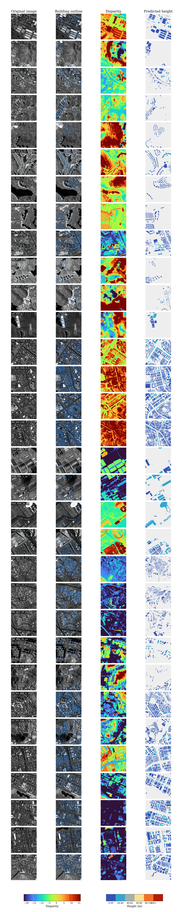
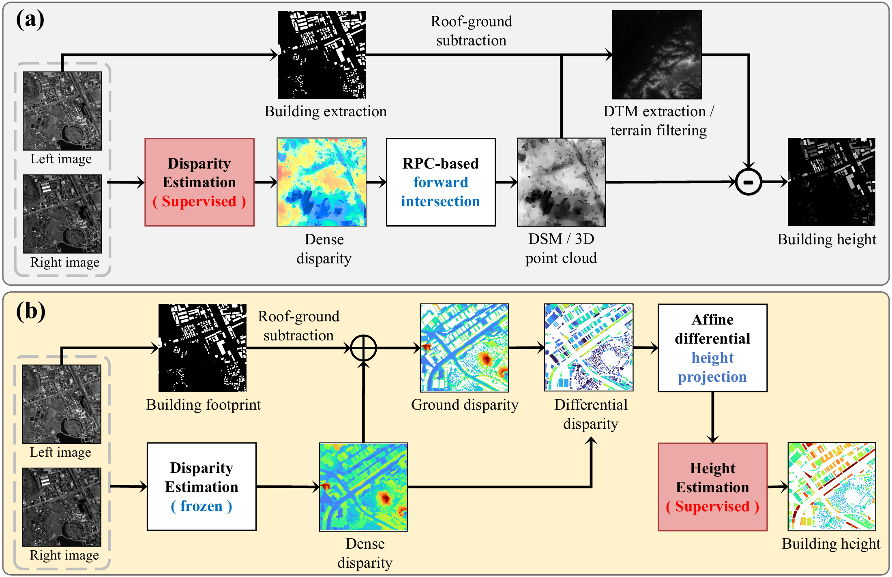
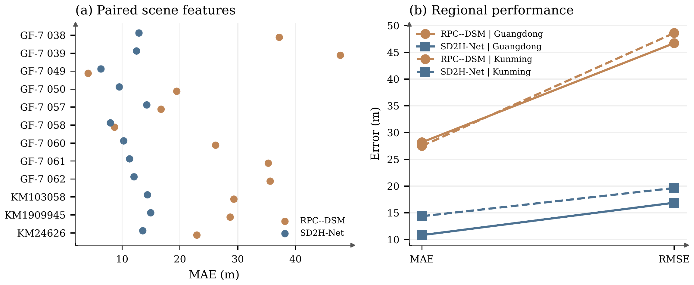
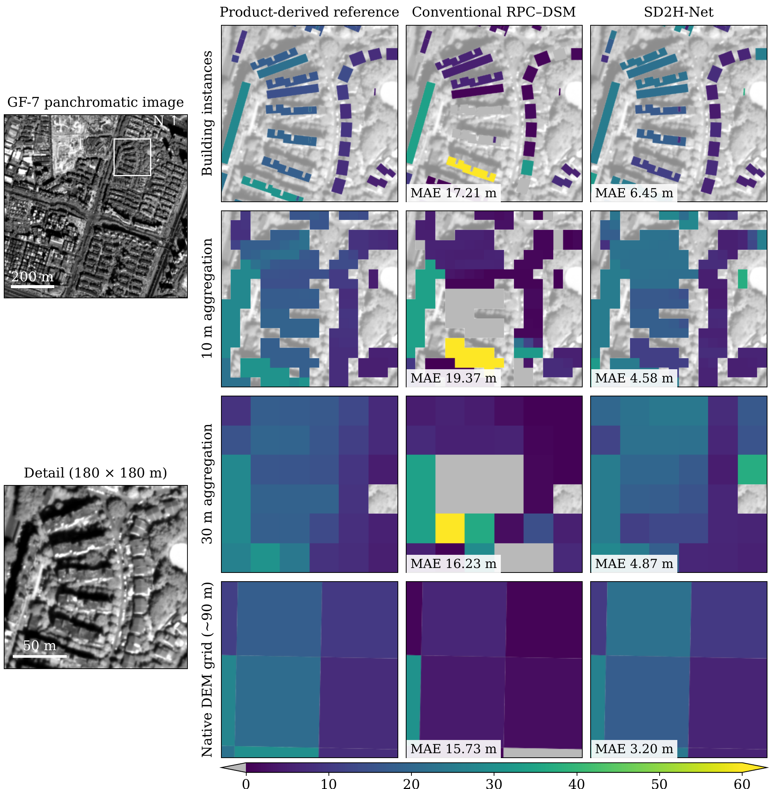

# SD2H-Net: Physics-Guided Building Height Estimation from GF-7 Stereo Imagery

SD2H-Net estimates building height from GF-7 stereo imagery using local roof-ground differential disparity and instance-level height calibration with product-derived height labels.

The training workflow has two stages: stereo disparity pre-training on WHU-SSIDE, followed by building-height adaptation on UnifiedBH with the stereo front end frozen. The RPC-DSM comparison workflow is provided in [`rpc_dsm/`](rpc_dsm/README.md).


The figure below illustrates representative UnifiedBH patches and the intermediate products used by SD2H-Net. From left to right, each row shows the original GF-7 patch, the same patch with all pre-filtering building-label contours overlaid in blue, the pre-trained stereo disparity map, and the final building-height prediction map.



## Repository layout

```text
config/                             Training and protocol configurations
core/                               Stereo and building-height models and datasets
tools/                              Mask, cache, filter and protocol preparation
reproduction/run_pipeline.py         Configurable stage launcher
rpc_dsm/                            Raw GF-7 stereo to RPC-DSM building heights
train_pretrain.py                   WHU-SSIDE disparity pre-training
train_finetune.py                   UnifiedBH height adaptation
evaluate_stereo.py                  Disparity evaluation
evaluate_height.py                  Building-height evaluation
precompute_unifiedbh_disp_delta.py  Disparity, local-ground and differential caches
```

## Environment

The verified development environment uses Python 3.8, PyTorch 2.4.1, Accelerate 1.0.1 and timm 0.6.13. Use a CUDA-enabled PyTorch installation for training.

```bash
conda create -n sd2h python=3.8 -y
conda activate sd2h
pip install torch==2.4.1 torchvision==0.19.1 --index-url https://download.pytorch.org/whl/cu121
pip install accelerate==1.0.1 hydra-core omegaconf tqdm numpy scipy opencv-python \
  scikit-image matplotlib pillow timm==0.6.13 wandb scikit-learn rasterio
```

RPC-DSM additionally requires GDAL, rpcm and s2p with its native tools; see its [environment instructions](rpc_dsm/README.md#environment).

## Weights and data

Supply model weights locally. Place the selected Depth Anything V2 checkpoint at `pretrained/depth_anything_v2_vitb.pth` for the default ViT-B configuration. Stereo and height checkpoints are written to `checkpoints/` during training.

Download [WHU-SSIDE](https://github.com/zhanggb1997/WHU-SSIDE) from its authors and organize it as:

```text
WHU-SSIDE/
├── train/{ImageL,ImageR,Disp}/
└── valtest/{ImageL,ImageR,Disp}/
```

UnifiedBH `overlap15` is available from [Baidu Netdisk](https://pan.baidu.com/s/1i1sF8wnDNjp2yV-oGfpl1Q?pwd=bhey), extraction code `bhey`:

```text
UnifiedBH/overlap15/
├── left/<CITY>/*.tif
├── right/<CITY>/*.tif
├── label/<CITY>/*.tif
├── mask/<CITY>/*.tif
└── disp/<CACHE>/
    ├── disp_npy/
    ├── delta_abs_npy/
    ├── local_ground_npy/
    └── instance_metrics.csv
```

The retained cache stores disparity, absolute roof-ground differential disparity and local-ground disparity. Directional statistics are derived in memory when needed.

The default city identifiers are `HZ_049 HZ_050 HZ_057 HZ_DG_058 SZ_060 SZ_061 HK_062 SZ_DG_038 PRE_039`.

Set paths to your local data and cache:

```bash
export WHU=/path/to/WHU-SSIDE
export DATA=/path/to/UnifiedBH/overlap15
export CACHE="$DATA/disp/sd2h_full9_abs_groundfix_whusside724_20260622"
```

If instance masks are absent, create them from the height-label connected components:

```bash
python tools/generate_unifiedbh_masks.py --data-root "$DATA" --workers 8
```

## 1. Stereo pre-training

```bash
python reproduction/run_pipeline.py --stage pretrain \
  --data-root "$WHU" --gpu 0,1,2,3 --num-processes 4 --batch-size 4
```

The default configuration is `config/train_pretrain.yaml`. The trained checkpoint is saved under `checkpoints/pretrain_whusside_60ep_724/`.

To evaluate an existing stereo checkpoint:

```bash
python evaluate_stereo.py \
  --restore_ckpt checkpoints/pretrain_whusside_60ep_724/final.pth \
  --data_path "$WHU/valtest" --dataset whusside \
  --valid_iters 16 --batch_size 1 --mixed_precision
```

## 2. Build disparity and differential-disparity caches

```bash
python reproduction/run_pipeline.py --stage precompute \
  --data-root "$DATA" --cache-root "$CACHE" \
  --stereo-checkpoint checkpoints/pretrain_whusside_60ep_724/final.pth --gpu 0
```

This keeps stereo evidence fixed for height adaptation. For direct invocation, the output option is `--output_directory`.

## 3. Prepare filtering and train/validation protocols

```bash
python reproduction/run_pipeline.py --stage prepare \
  --data-root "$DATA" --cache-root "$CACHE"
```

This synchronizes caches with the selected tiles, rebuilds instance statistics, creates the noisy-instance filter, and generates the train/validation manifests and calibrated configurations. It fits calibration coefficients using the training subset only.

Manifests are saved under `checkpoints/stereo_calibration_protocols_seed724/`; generated configurations are written to `config/`. The protocols are intra-city 10/90, 20/80, 50/50 and cross-city transfer.

## 4. Height adaptation

Train one protocol:

```bash
python reproduction/run_pipeline.py --stage train \
  --data-root "$DATA" --cache-root "$CACHE" \
  --config-name train_city_stratified_50_50 --gpu 0 --batch-size 1
```

Or train the prepared protocols sequentially:

```bash
PY=python GPU_IDS=0 NUM_PROCS=1 bash run_train_stereo_calibration_protocols.sh
```

The height configuration controls instance filtering, height-loss settings, calibration and checkpoint selection. `height_delta_source: precomputed` uses the retained cache without updating the stereo front end.

## 5. Height evaluation

```bash
python reproduction/run_pipeline.py --stage evaluate \
  --data-root "$DATA" \
  --height-config config/train_city_stratified_50_50.yaml \
  --height-checkpoint checkpoints/city_stratified_50_50/finetune_best_rmse.pth \
  --output-root outputs/city_stratified_50_50_eval --gpu 0
```

The selected configuration supplies the cache and validation-manifest paths. Use the matching configuration and checkpoint together.

## RPC-DSM workflow

```bash
python -m rpc_dsm.pipeline \
  --raw-root /path/to/GF7_raw \
  --label /path/to/buildings.shp \
  --checkpoint checkpoints/pretrain_whusside_60ep_724/final.pth \
  --output-root outputs/rpc_dsm_run --gpus 0
```

The stages are preparation, rectification, common cropping, disparity, RPC triangulation, geolocation, projection, label alignment and building-height extraction. See [`rpc_dsm/README.md`](rpc_dsm/README.md) for inputs, stage resumption and output definitions.

Add `--dry-run` to the stage launcher to inspect a command before executing it. A compact command reference is available in [`reproduction/README.md`](reproduction/README.md).

## Citation

If this repository is useful for your research, please cite the corresponding paper after publication.

## License

Please follow the applicable source-code, model-weight and satellite-data licenses and redistribution terms.

<!-- SD2H-ADDITIONAL-VISUALIZATIONS-START -->
## Additional Visualizations

### Workflow



### Paired regional evaluation



### Local comparison across spatial supports



<!-- SD2H-ADDITIONAL-VISUALIZATIONS-END -->
